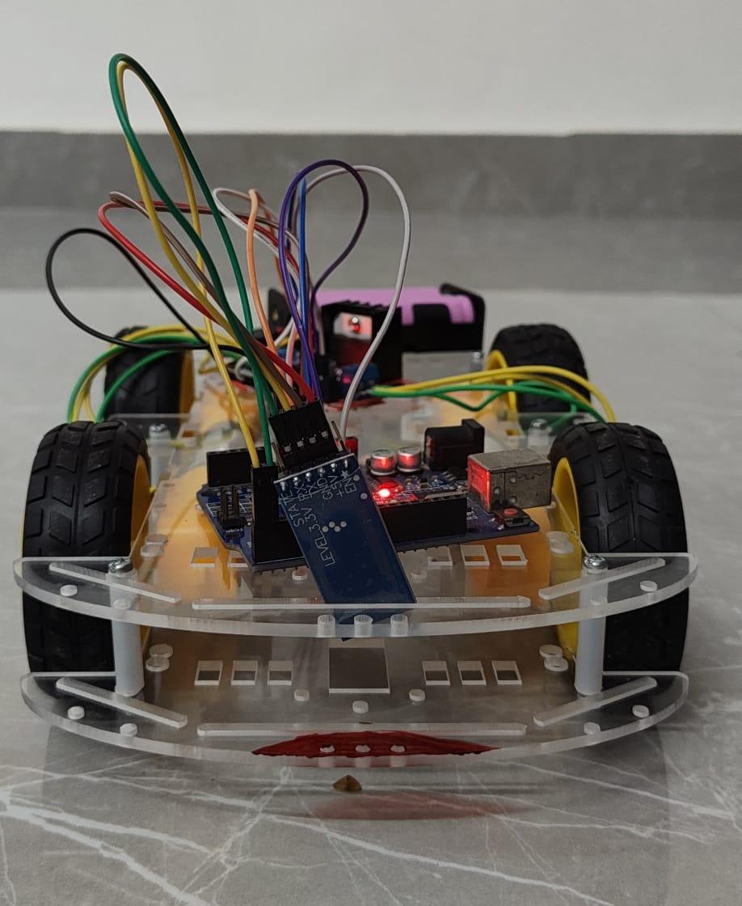
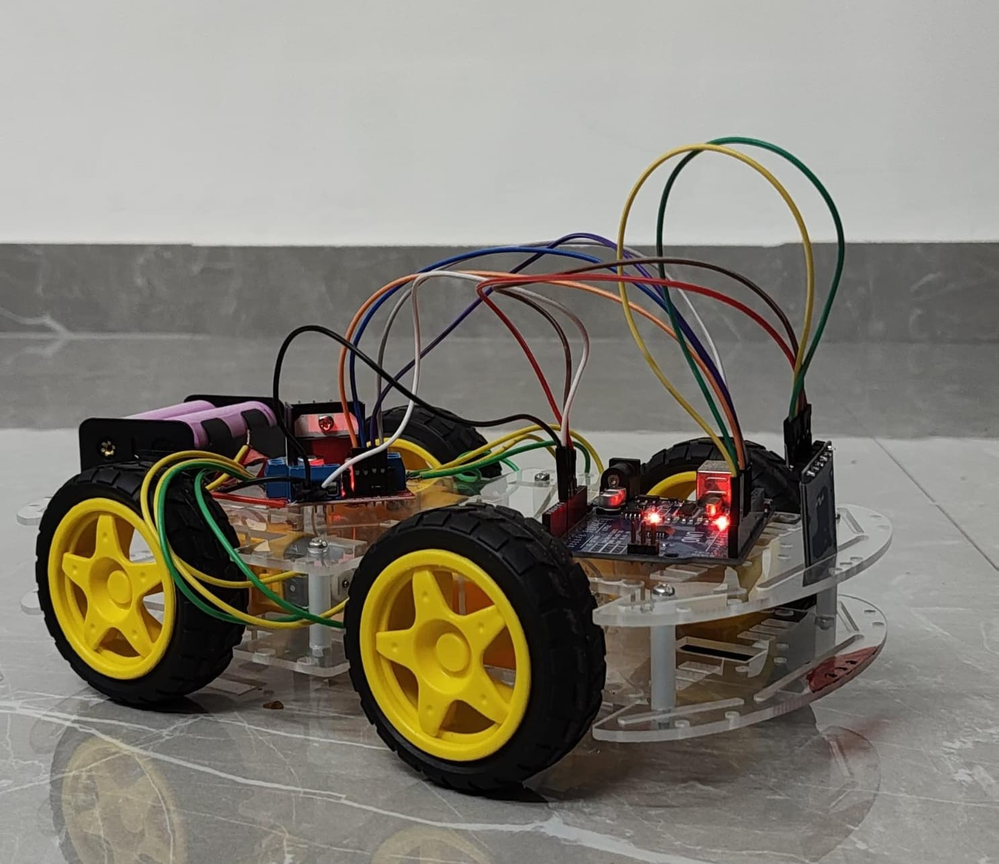
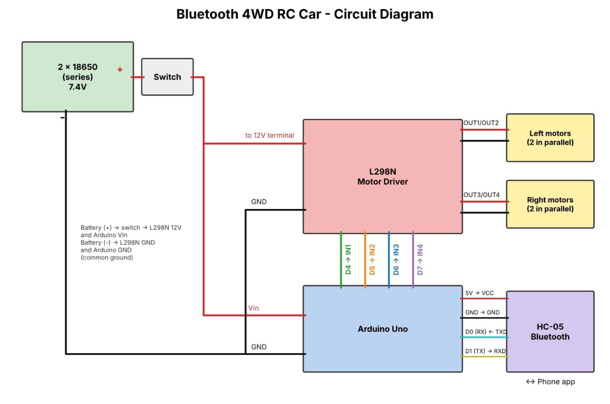

# Bluetooth Controlled 4WD RC Car

A 4-wheel-drive RC car controlled from an Android phone over Bluetooth, built with an Arduino Uno, an L298N motor driver and an HC-05 Bluetooth module.




## Features
- Forward, backward, left and right (pivot turns)
- Diagonal movements
- Wireless control from a phone over Bluetooth
- Simple, beginner-friendly code

## Components
| Component | Quantity |
|---|---|
| Arduino Uno | 1 |
| L298N motor driver module | 1 |
| HC-05 Bluetooth module | 1 |
| BO gear motors (yellow, with wheels) | 4 |
| 18650 Li-ion cells (3.7V each, in series = 7.4V) with holder | 2 |
| 4WD acrylic chassis, jumper wires, switch | as needed |

## Circuit Diagram


Text version of every connection: [circuit/connections.md](circuit/connections.md)

### Pin connections
| Arduino Pin | Connected To | Function |
|---|---|---|
| D4 | L298N IN1 | Left motors forward |
| D5 | L298N IN2 | Left motors backward |
| D6 | L298N IN3 | Right motors forward |
| D7 | L298N IN4 | Right motors backward |
| D0 (RX) | HC-05 TXD | Bluetooth data in |
| D1 (TX) | HC-05 RXD | Bluetooth data out |
| 5V / GND | HC-05 VCC / GND | Bluetooth power |
| Vin | Battery (+) 7.4V | Arduino power |
| GND | L298N GND + battery (-) | Common ground |

- The two left motors are wired in parallel to L298N OUT1/OUT2.
- The two right motors are wired in parallel to L298N OUT3/OUT4.
- The L298N 12V terminal (motor supply input) is connected to the battery (+).
- Keep the ENA and ENB jumpers on the L298N in place.

## Code
Open `code/rc_car/rc_car.ino` in the Arduino IDE and upload it to the Arduino Uno.

## How to Use
1. Wire the circuit as shown above.
2. Unplug the HC-05 TXD/RXD wires from pins 0 and 1, then upload the code.
3. Reconnect the HC-05 and switch on the car.
4. Pair your phone with the HC-05 (default PIN is usually `1234` or `0000`).
5. Open the [HC-05 Bluetooth Arduino Control app](https://play.google.com/store/apps/details?id=com.giristudio.hc05.bluetooth.arduino.control), connect to the HC-05 and drive the car.

## Repository Structure
```
RC-Car/
├── README.md
├── code/
│   └── rc_car/
│       └── rc_car.ino
├── images/
│   ├── rc-car-front.jpg
│   └── rc-car-side.jpg
└── circuit/
    ├── circuit-diagram.png
    └── connections.md
```

## Author
Built by Nithish R.
